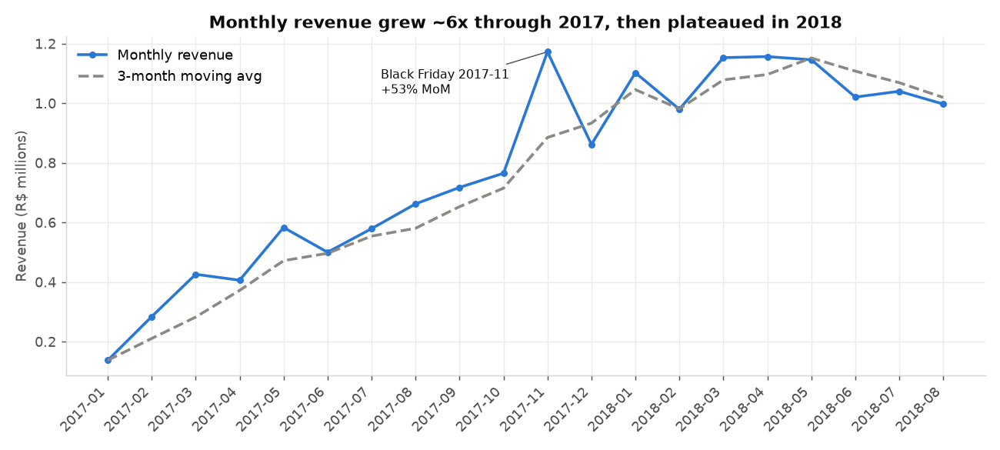
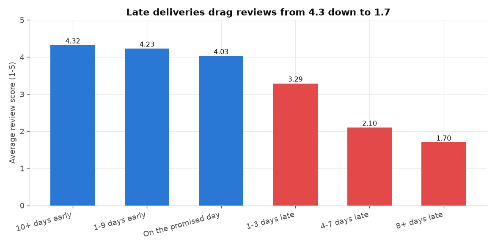

# Olist Marketplace Performance Analytics

SQL analytics project on the public **Olist Brazilian E-Commerce dataset** (99,441 orders, Sep-2016 to Oct-2018, 9 relational tables). The raw tables are modelled into a **PostgreSQL star schema**, and window-function SQL answers three business questions:

1. **How is the marketplace growing?** Month-over-month (MoM) and year-over-year revenue growth.
2. **Who are our customers?** RFM (Recency, Frequency, Monetary) segmentation.
3. **Where does delivery break down, and what does it cost us?** Delivery-delay analysis.

**Stack:** PostgreSQL 16 · SQL (CTEs, window functions) · Python (pandas, SQLAlchemy, matplotlib for export/charts)

---

## Key findings

| Area | Finding |
|---|---|
| Growth | Monthly revenue rose from R$0.14M (Jan-2017) to R$1.17M (Nov-2017). Black Friday month was +53% MoM. 2018 plateaued at R$1.0–1.16M/month. Jan–Aug 2018 revenue was +140% vs Jan–Aug 2017. |
| Growth | R$15.69M revenue over the 20 full months; average order value R$160. Top categories: health_beauty, watches_gifts, bed_bath_table. |
| Customers | **97% of customers bought only once.** Repeat buyers (Champions + Loyal) are 3% of customers and 5.6% of revenue. Retention is the biggest lever. |
| Customers | "At risk high-value" customers (no purchase in ~13 months, top-40% spend) hold 27.5% of revenue. They are the win-back target. |
| Delivery | 6.8% of delivered orders were late. Average delivery 12.6 days against an average promise of 24.4 days, so the promise is padded. |
| Delivery | **Lateness destroys reviews:** avg score 4.3 when 10+ days early, 3.3 when 1–3 days late, 1.7 when 8+ days late (79% of those are 1–2 stars). |
| Delivery | 72% of late orders had the seller hand over on time; the logistics leg caused the delay. Inter-state orders take 15.1 days vs 7.9 same-state and are late 8.1% vs 4.5%. |
| Delivery | Late rates are worst in the North-East (AL 21%, MA 17%, SE 15%). Remote northern states (AM, AP) are slowest but rarely late because their promises are padded more. |




---

## Data model (star schema)

```
                     dim_date
                        |
 dim_customer ----- fact_orders              grain: 1 row per ORDER     (99,441)
      |                 |  order_id
      +----------- fact_order_items --- dim_product   grain: 1 row per ITEM (112,650)
                        |
                    dim_seller
```

| Table | Grain / purpose | Rows |
|---|---|---|
| `dw.fact_orders` | One row per order: status, timestamps, totals, payment, review, delivery metrics | 99,441 |
| `dw.fact_order_items` | One row per item: price, freight, product, seller | 112,650 |
| `dw.dim_customer` | One row per **real person** (`customer_unique_id`) with location | 96,096 |
| `dw.dim_product` | Product with English category | 32,951 |
| `dw.dim_seller` | Seller with location | 3,095 |
| `dw.dim_date` | Calendar 2016–2018, key = `YYYYMMDD` | 1,096 |

The 9 source tables map in as follows. Orders, items, payments and reviews become the two facts (payments and reviews are aggregated to order level). Customers, sellers and products become dimensions. Category translation is folded into `dim_product`. Geolocation (1M rows) is averaged to one lat/lng per zip and folded into the customer and seller dimensions.

## Data quality issues handled

| Issue found (`sql/03`) | Fix (`sql/04`) |
|---|---|
| `customer_id` is generated per order (99,441 ids, only 96,096 people) | `dim_customer` keyed on `customer_unique_id` |
| 23,995 customer zips lost their leading zero ("1037" vs "01037") | `LPAD(zip, 5, '0')` before joining geolocation |
| 547 orders have more than 1 review; 814 duplicate review ids | Keep latest review per order (`ROW_NUMBER`) |
| 8 "delivered" orders without a delivery date | Delivery metrics only when status = delivered AND date present |
| 610 products without category; 2 categories untranslated | Manual mapping, else `'unknown'` |
| 775 orders with no items, 1 without payment | `LEFT JOIN` + `COALESCE` so no order is dropped |
| Sparse edge months (2016, Sep/Oct-2018) | Trend analysis restricted to Jan-2017 – Aug-2018 |
| 1M geolocation rows for 19K zips | `AVG(lat/lng)` per zip |

Every load is reconciled: warehouse row counts and total item revenue (R$13,591,643.70) match staging exactly.

---

## Project structure

```
sql/
  01_staging_tables.sql      raw landing tables (1 per CSV)
  02_load_staging.sql        \copy bulk load + row counts
  03_data_quality_checks.sql profiling queries that justify each cleaning rule
  04_star_schema.sql         dims, facts, keys, indexes, reconciliation
  05_mom_growth.sql          LAG, moving average, running total, RANK by month
  06_rfm_segmentation.sql    NTILE scoring, segments, share-of-total
  07_delivery_delay.sql      KPIs, delay vs review, state RANK, root cause, seller PERCENT_RANK
python/export_results.py     exports analytics views to CSV + draws charts
outputs/results/             CSV of every analysis view
outputs/charts/              PNG charts
python/run_pipeline.py       one-command build: load CSVs, run all SQL, export
python/config.py             database connection settings (edit the password)
```

## How to run

1. Install PostgreSQL 14+ and Python 3.10+.
2. Download the dataset from Kaggle ("Brazilian E-Commerce Public Dataset by Olist") and put the 9 CSVs in `data/`.
3. Create an empty database called `olist` (for example in pgAdmin).
4. Put your Postgres password in `python/config.py`.
5. Run:
   ```bash
   pip install -r requirements.txt
   python python/run_pipeline.py
   ```
This loads the CSVs, builds the star schema, runs all three analyses and writes the CSVs and charts to `outputs/`, in about 30 seconds.

`sql/02_load_staging.sql` is an alternative loader for people who prefer `psql` (`\copy`); the Python pipeline does the same load itself.
